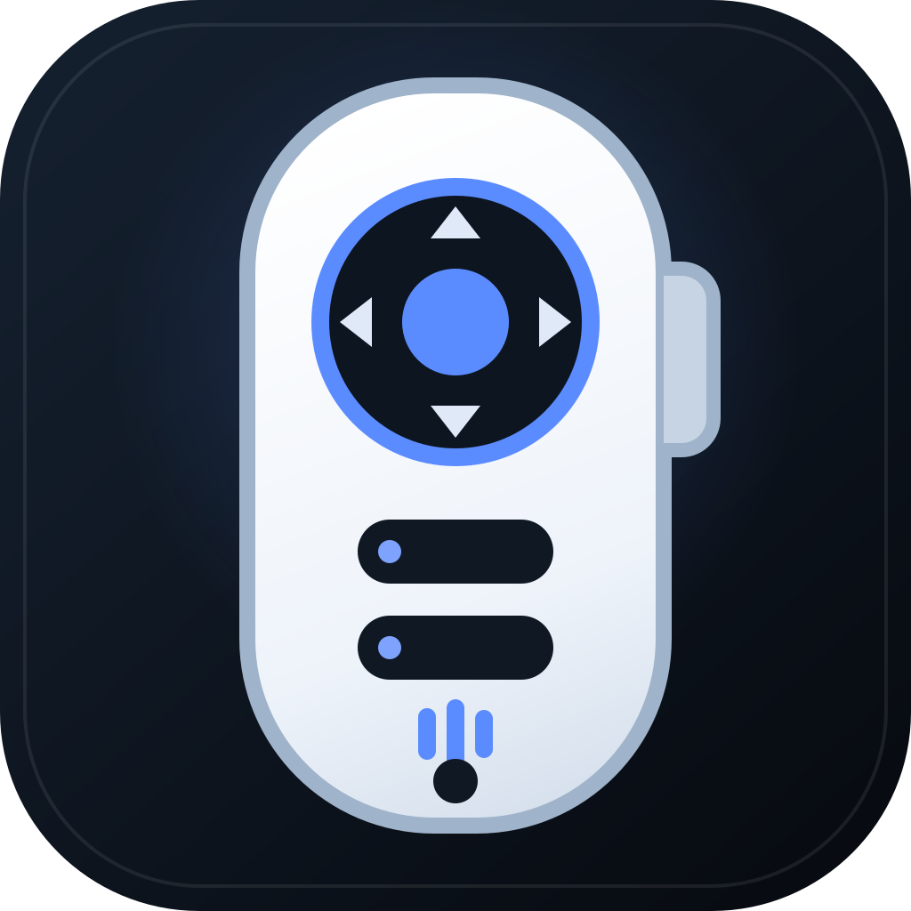
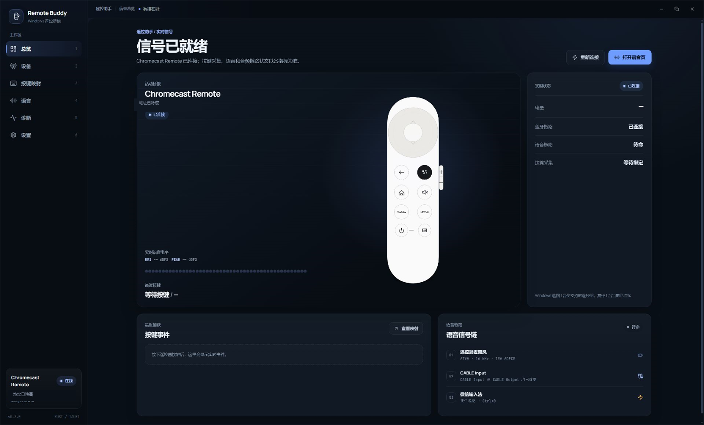
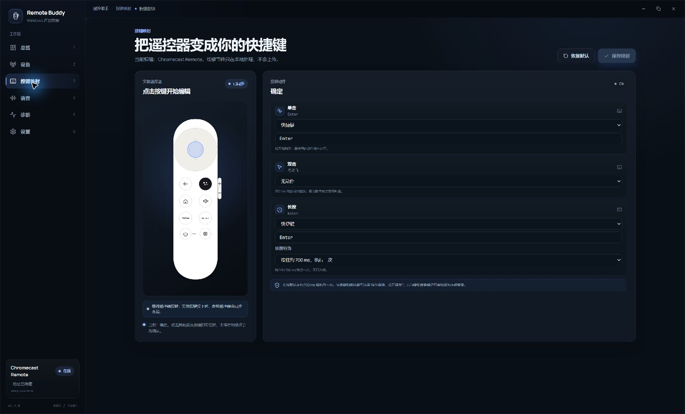
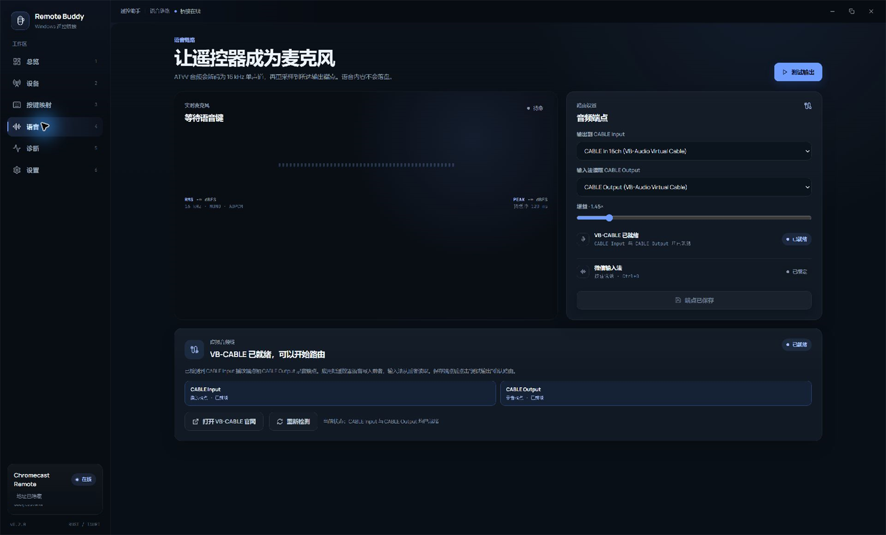
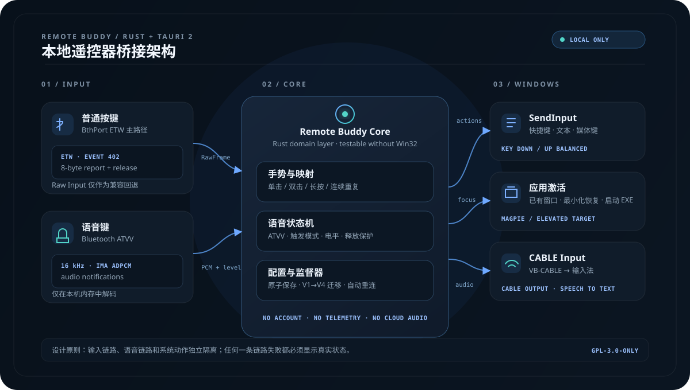

<div align="center">



# Remote Buddy

**把 Chromecast with Google TV 遥控器变成 Windows 的快捷键、应用启动器和无线麦克风。**

[](https://github.com/jimmieyangcsjs/remote-buddy-rust/releases)
[](LICENSE)
[](#系统要求)
[](rust-toolchain.toml)
[](https://tauri.app/)

[下载安装包](https://github.com/jimmieyangcsjs/remote-buddy-rust/releases/latest) ·
[用户手册](docs/USER_GUIDE.md) ·
[功能说明](docs/FEATURES.md) ·
[问题反馈](https://github.com/jimmieyangcsjs/remote-buddy-rust/issues)

</div>

---

## AI 辅助开发声明

本项目在需求分析、架构设计、代码实现、测试和文档整理过程中使用了 **DeepSeek** 进行 AI 辅助编程。所有提交由项目维护者审核，维护者对最终代码、发布包和运行结果负责。

DeepSeek 是独立的第三方服务。本项目与其运营方不存在隶属、代理或官方背书关系。

## 参考项目声明

本项目在产品目标、Chromecast 遥控器协议研究和使用流程上参考了
[zfdang/remote-buddy-windows](https://github.com/zfdang/remote-buddy-windows)。

Rust + Tauri 2 实现为本项目独立开发。上游项目的代码、文档、名称和相关权利归其原作者所有；本项目不宣称获得上游作者或 Google 的官方认可。上游项目采用 GPL-3.0 许可证，相关说明见 [开源与合规](docs/OPEN_SOURCE.md)。

## 软件简介

Remote Buddy 是一个完全在本机运行的 Windows 遥控器桥接工具。它面向已经与 Windows 配对的 **Chromecast with Google TV 遥控器（Google G9N9N）**，解决两个问题：

1. Windows 默认不能把遥控器普通按键稳定地交给普通桌面应用；
2. 遥控器语音键需要通过 ATVV 蓝牙音频链路接入输入法。

程序会把普通按键转换为快捷键、文本、媒体控制或应用切换动作，并把语音键接收到的音频写入 VB-CABLE，由微信输入法、搜狗输入法或其他工具完成语音转文字。



## 功能一览

| 模块 | 功能 | 说明 |
| --- | --- | --- |
| 设备 | 自动发现与连接 | 读取 Windows 已配对的受支持遥控器，自动导入并后台重连 |
| 设备 | 多设备管理 | 保存多个遥控器配置，选择当前设备并单独编辑映射 |
| 按键 | 虚拟遥控器联动 | 实体按键按下时，对应虚拟按键实时高亮、下沉并显示事件 |
| 按键 | 单击 / 双击 / 长按 | 三种手势可分别配置；长按支持“触发一次”或“按住保持” |
| 按键 | 连续重复 | 方向键和音量键可按住连续触发，间隔可调 |
| 动作 | 快捷键 | 自动录制组合键，支持普通键、功能键、方向键和媒体键 |
| 动作 | 文本输入 | 将预设文本发送到当前前台窗口 |
| 动作 | 媒体控制 | 音量加、音量减、静音、播放/暂停 |
| 动作 | 切换应用 | 从运行窗口中选择应用，或手动指定 EXE；未运行时自动启动 |
| 语音 | ATVV 无线麦克风 | 接收遥控器麦克风音频，解码为 16 kHz PCM 并输出到 CABLE Input |
| 语音 | 实时电平 | 显示实际 RMS / PEAK dBFS 与波形，不做装饰性假动画 |
| 语音 | 多种触发模式 | 按住说话、点击切换、智能免提三类输入法触发方式 |
| 系统 | 托盘常驻 | 关闭到托盘、后台重连、最近按键状态和快捷操作 |
| 系统 | 管理员权限 | 可在设置中请求提权，改善切换高权限应用和恢复窗口的可靠性 |
| 系统 | 中英双语 | 默认简体中文，可在设置中切换 English |
| 诊断 | 链路可视化 | 蓝牙发现、按键采集、ATVV、VB-CABLE、WebView2 状态集中展示 |
| 隐私 | 本地优先 | 无账号、无遥测、无云端音频、无转写文本上传 |





## 下载与安装

前往 [Releases](https://github.com/jimmieyangcsjs/remote-buddy-rust/releases/latest) 下载最新版本。每个版本同时提供：

- `Remote-Buddy_0.2.0_x64-setup.exe`：推荐使用的 NSIS 安装包，按当前用户安装。
- `remote-buddy-desktop.exe`：独立运行版，适合已经安装 WebView2 的电脑。
- `SHA256SUMS.txt`：发布文件校验值。

当前发布包未进行商业代码签名，Windows SmartScreen 可能显示“未知发布者”。请只从上述 GitHub Releases 页面下载，并使用 `SHA256SUMS.txt` 校验文件。

## 快速开始

### 1. 配对遥控器

打开 Windows“设置 → 蓝牙和其他设备”，配对 `Chromecast Remote`，然后按一下遥控器按键唤醒设备。

### 2. 启动并连接

启动 Remote Buddy，进入“设备”页。程序通常会自动导入并连接已配对遥控器；如果没有自动出现，点击“扫描 Windows 设备”，选中设备后点击“连接设备”。

### 3. 启用实体按键

Windows 默认会省略 BthPort ETW 中的完整按键载荷。首次使用时：

1. 打开“诊断”页；
2. 点击“启用按键增强”；
3. 在 UAC 中选择“是”；
4. 关闭并重新打开 Windows 蓝牙，或重启电脑；
5. 重新启动 Remote Buddy。

该步骤只在本机写入三个 BthPort 诊断值，不会联网或上传数据。详细说明见 [用户手册](docs/USER_GUIDE.md#3-启用实体按键)。

### 4. 配置按键映射

进入“按键映射”页，点击虚拟遥控器上的按键，为该按键的单击、双击和长按分别设置动作。保存后立即生效，不要求重启或重新选择设备。

### 5. 配置语音输入

1. 从 [VB-Audio 官方页面](https://vb-audio.com/Cable/) 安装 VB-CABLE；
2. 在 Remote Buddy 语音页选择 `CABLE Input` 作为输出端点；
3. 在微信输入法中开启“快捷键全局生效”，麦克风选择 `CABLE Output`；
4. 让输入法语音快捷键与 Remote Buddy 中保存的快捷键一致；
5. 按住遥控器语音键说话，松开后由输入法完成转写。

完整步骤和排错方法见 [用户手册](docs/USER_GUIDE.md)。

## 系统要求

| 项目 | 要求 |
| --- | --- |
| 操作系统 | Windows 10 19041+ 或 Windows 11 |
| 架构 | **仅 x64**；不提供 32 位版本 |
| 运行库 | Microsoft Edge WebView2 Runtime |
| 遥控器 | Chromecast with Google TV 遥控器，型号 Google G9N9N |
| 语音 | VB-CABLE；推荐微信输入法或搜狗输入法 |
| 权限 | 首次启用按键增强需要 UAC；管理员运行可改善高权限应用切换 |

本版本面向 Windows 10 19041+ 与 Windows 11 x64，使用相同的 x64 构建目标。当前发布包的自动化验证在 Windows 10 19044 x64 上完成；Windows 11 共享主要 API 和构建配置，但不同蓝牙适配器、驱动和系统策略仍可能影响 ETW 行为，建议在目标电脑上按“诊断”页逐项确认。

## 工作原理



```text
普通按键：
BthPort ETW / Raw Input → 解码 → 手势识别 → 映射 → SendInput / ShellExecute

语音：
遥控器麦克风 → Bluetooth ATVV → IMA ADPCM 解码 → 16 kHz PCM
→ CABLE Input → VB-CABLE → CABLE Output → 输入法语音转文字
```

程序由三部分组成：

- `crates/core`：配置迁移、ATVV 编解码、ADPCM、手势、映射和设备监督器；
- `crates/windows`：BLE/GATT、BthPort ETW、WASAPI、SendInput、窗口切换与提权；
- `apps/desktop` + `ui`：Tauri 命令、托盘、输入路由、语音会话和 React 界面。

更多技术细节见 [架构说明](docs/ARCHITECTURE.md) 和 [协议记录](docs/PROTOCOL.md)。

## 常用操作

| 操作 | 方式 |
| --- | --- |
| 切换页面 | 数字键 `1`–`6`，或点击左侧导航 |
| 移动窗口 | 拖动顶部标题栏 |
| 最大化 / 还原 | 点击右上角按钮，或双击标题栏 |
| 关闭到托盘 | 设置中开启后，点击关闭按钮只隐藏窗口 |
| 显示主窗口 | 单击托盘图标，或右键托盘菜单选择“显示主窗口” |
| 录制快捷键 | 点击快捷键输入框后直接按键，`Esc` 取消 |
| 重新连接 | 总览页“重新连接”、托盘菜单或设备页“连接设备” |
| 查看最近按键 | 总览页事件区或托盘右键菜单 |

## 数据与隐私

- 配置：`%APPDATA%\RemoteBuddy\config.json`
- 配置备份：`%APPDATA%\RemoteBuddy\config.backup.json`
- 日志：`%APPDATA%\RemoteBuddy\logs\rust-app.log`
- 诊断包：`%APPDATA%\RemoteBuddy\diagnostics\`

程序没有账号系统、遥测、广告或云端音频。诊断包中的设备名、蓝牙地址和日志可能包含本机信息，分享前应检查并脱敏。完整说明见 [隐私说明](PRIVACY.md)。

## 已实现的质量措施

- Rust 核心与 Windows 平台层分离，便于单元测试和后续扩展。
- 配置使用原子写入；升级前保留备份，并迁移旧版字段。
- 单实例运行，避免多个托盘和多个 ETW 会话。
- 关闭窗口后可保持后台连接与自动重连。
- 应用切换适配 Magpie 等置顶覆盖窗口，并支持重新激活高权限应用。
- 双显示器、最大化、还原和 DPI 变化后主动修复 WebView 客户区布局。
- Release 构建使用 LTO、单 codegen unit、符号剥离和静态 MSVC 运行库。

自动化验证记录见 [验证记录](docs/validation.md)。

## 开发与构建

需要安装：

1. Visual Studio 2022 Build Tools，包含“使用 C++ 的桌面开发”和 Windows SDK；
2. Rust stable 1.89+，目标 `x86_64-pc-windows-msvc`；
3. Node.js 22+ 和 pnpm；
4. Microsoft Edge WebView2 Runtime；
5. 语音开发与验收需要 VB-CABLE。

```powershell
pnpm --dir ui install
pnpm --dir ui test
pnpm --dir ui build
cargo test --workspace
cargo clippy --workspace --all-targets -- -D warnings
```

构建 Release EXE 和 NSIS 安装包：

```powershell
.\scripts\build.ps1 -Configuration Release
```

输出：

```text
target\release\remote-buddy-desktop.exe
target\release\bundle\nsis\Remote Buddy_0.2.0_x64-setup.exe
```

开发说明见 [DEVELOPMENT.md](docs/DEVELOPMENT.md)，贡献流程见 [CONTRIBUTING.md](CONTRIBUTING.md)。

## 已知限制

- 普通实体按键依赖 Windows BthPort ETW 的完整载荷，首次需要 UAC 配置并重新加载蓝牙驱动。
- 不同蓝牙适配器、驱动版本和企业安全策略可能限制 ETW；程序会显示实际状态，不会伪造“已就绪”。
- 语音识别由第三方输入法完成，本项目不包含语音识别模型，也不保存音频或转写文本。
- VB-CABLE 为第三方软件，不随本项目分发。
- 切换到以管理员身份运行的目标应用时，Remote Buddy 也需要以管理员权限运行。
- 某些全屏游戏、反作弊程序、远程桌面或覆盖层软件可能拦截输入法和窗口切换。
- 当前安装包未签名，SmartScreen 可能提示未知发布者。
- 本项目不是 Google 官方产品，也不提供 Chromecast 固件或系统级蓝牙驱动修复。

## 相关文档

- [功能说明](docs/FEATURES.md)
- [用户手册](docs/USER_GUIDE.md)
- [开源与合规](docs/OPEN_SOURCE.md)
- [隐私说明](PRIVACY.md)
- [安全策略](SECURITY.md)
- [更新日志](CHANGELOG.md)
- [架构说明](docs/ARCHITECTURE.md)
- [协议记录](docs/PROTOCOL.md)
- [开发与验证](docs/DEVELOPMENT.md)
- [诊断说明](docs/DIAGNOSTICS.md)

## 致谢

- [zfdang/remote-buddy-windows](https://github.com/zfdang/remote-buddy-windows)：产品思路、设备协议研究和使用流程参考。
- [VB-Audio Virtual Cable](https://vb-audio.com/Cable/)：语音音频的本机虚拟环回端点。
- Rust、Tauri、React、Radix UI、Tailwind CSS、Lucide、Motion 及所有开源依赖的维护者。
- 参与实机测试、问题反馈和使用建议的用户。

## 许可证

本项目采用 **GNU General Public License v3.0 only（GPL-3.0-only）**，详见 [LICENSE](LICENSE)。

你可以自由使用、研究、修改和再分发本项目，但分发衍生作品时必须遵守 GPL-3.0 的源码公开和同许可证要求。本项目不提供任何担保，详见许可证中的免责声明。
